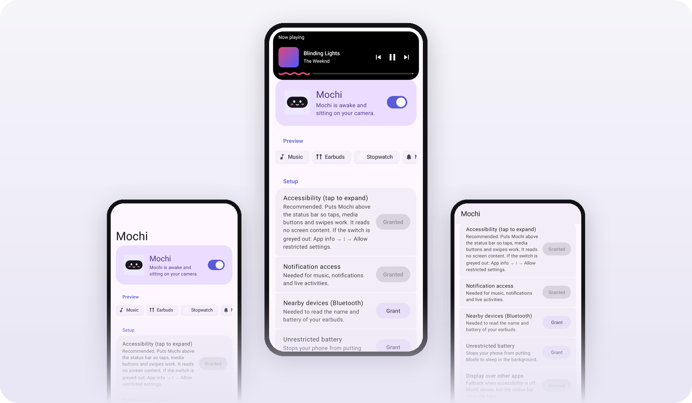
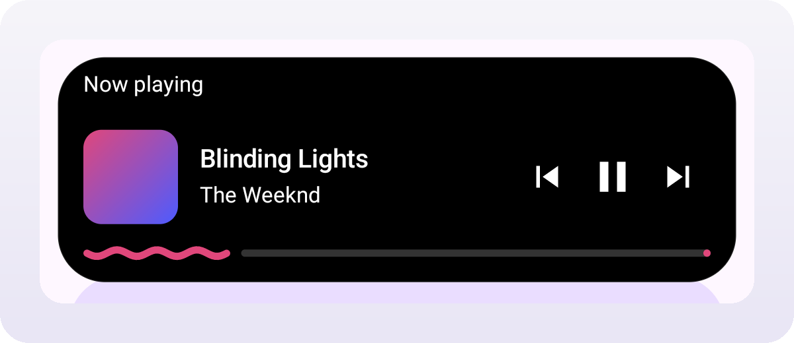
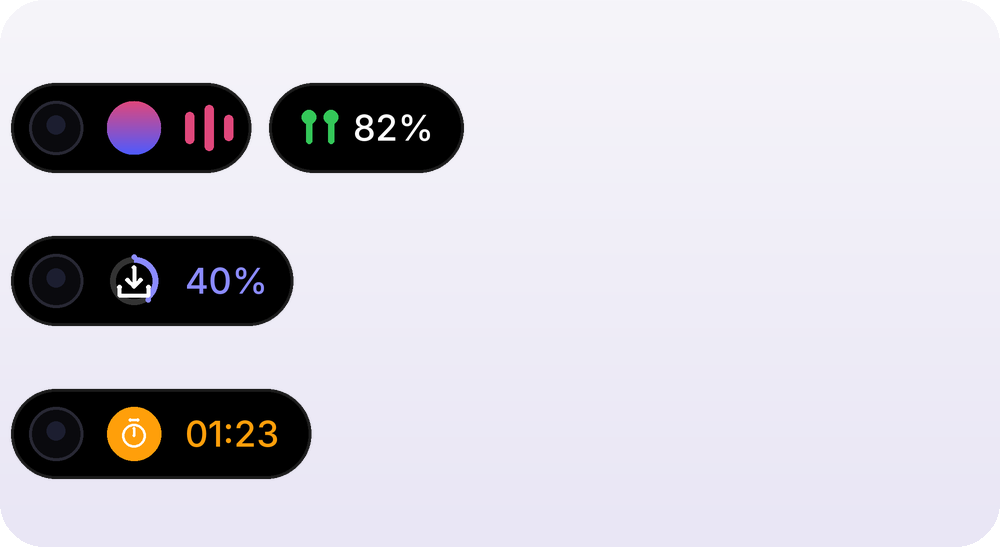
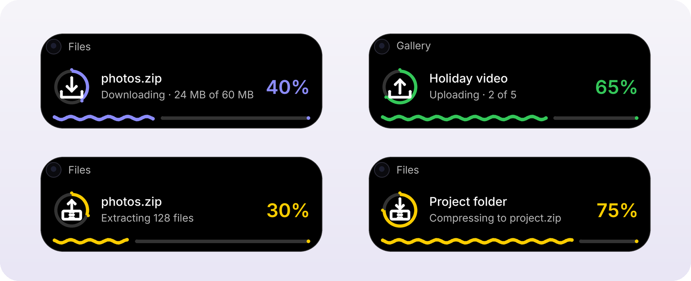
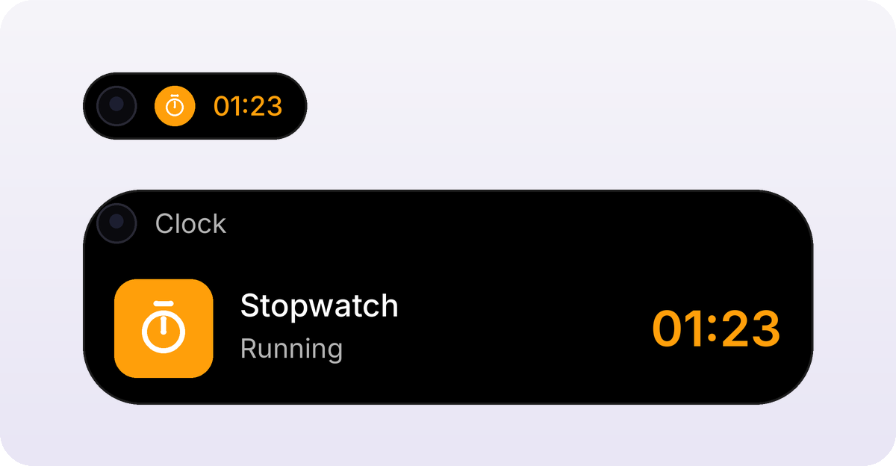
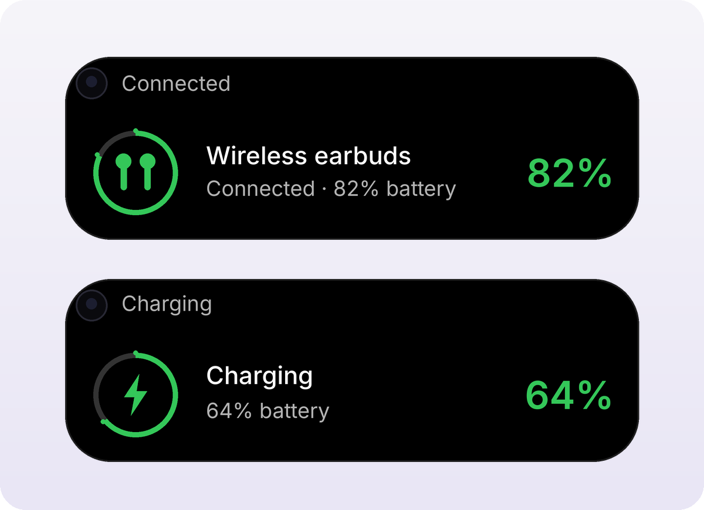
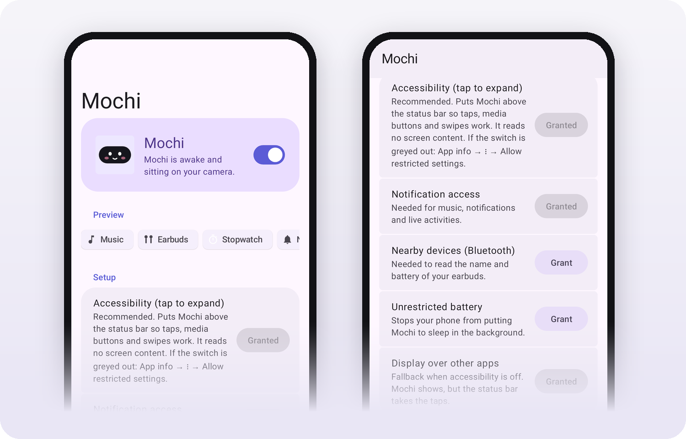

<div align="center">


# Mochi

**A soft, squishy Dynamic Island for Android.**<br>
Music, timers, downloads and your earbuds, wrapped neatly around your camera.

<a href="app/release/mochi-v1.9.3.apk"></a>


<a href="LICENSE"></a>

<br><br>



</div>

<br>

<table>
<tr>
<td width="33%" valign="top">

### Fits your camera

Mochi reads your camera's position from Android and wraps it perfectly. Need it exact? Line it up once by hand.

</td>
<td width="33%" valign="top">

### Fluid by design

Every change morphs with Material 3 Expressive springs. Mochi squishes, grows and settles instead of popping.

</td>
<td width="33%" valign="top">

### Light on battery

No polling and no idle drawing. When there is nothing to show, Mochi is gone until something happens.

</td>
</tr>
</table>

<br>

## Music that moves with you

Album art and live bars sit beside the camera while a song plays. Tap the pill to open a card with the track, playback controls and a wavy progress bar.

<p align="center"></p>
<p align="center"><sub>Screenshot</sub></p>

<p align="center"></p>
<p align="center"><sub>Illustration of the compact pills</sub></p>

## Downloads, uploads and archives at a glance

Mochi notices ongoing transfers in any app and gives each one its own animated icon inside a progress ring.

| | |
| --- | --- |
| **Downloading** | An arrow drops into a tray |
| **Uploading** | An arrow rises out of a tray |
| **Extracting** | An arrow lifts out of a zipped box |
| **Compressing** | An arrow drops into a zipped box |
| **Copying or moving** | Two sheets slide past each other |

<p align="center"></p>
<p align="center"><sub>Illustration</sub></p>

## Live activities

Stopwatches, timers, calls and navigation turn into a pill with a running clock. When a live activity starts, Mochi opens for a moment, then settles. Any music playing moves into a small bubble beside it.

<p align="center"></p>
<p align="center"><sub>Illustration</sub></p>

## Your earbuds, wired or wireless

Connect your earbuds and Mochi shows their name and battery in a ring, then tucks the percentage into a bubble next to the music. Wired and USB-C earphones are detected too, and plugging in a charger shows your battery.

<p align="center"></p>
<p align="center"><sub>Illustration</sub></p>

## Notifications, politely

New messages slide out from the camera with the app icon and two lines of text. Tap to open, swipe up to dismiss. Silent and repeat alerts stay quiet.

## Made for Material 3 Expressive

The settings app uses the latest Material 3 Expressive design: a large collapsing title, grouped rounded lists and connected button groups. Buttons change shape when you press them. On Android 12 and up, the colours come from your wallpaper.

<p align="center"></p>
<p align="center"><sub>Screenshots</sub></p>

<br>

## Easy on your battery

- **Event driven.** Music, Bluetooth, chargers and the screen all notify Mochi. It never checks on a timer.
- **Nothing on screen when idle.** The overlay window is removed when there is nothing to show and whenever the screen is off.
- **Small window.** The overlay is only as big as the pill, so the status bar keeps working around it.
- **Animations that stop.** Springs settle and sleep. Transfer icons move in short bursts, and the music bars can be turned off.
- **Private by default.** Mochi has no internet permission, so nothing leaves your phone.

<br>

## Get started

1. **Install** the [latest APK](app/release/mochi-v1.9.3.apk) on your phone.
2. **Grant access** from the Setup list in the app. Accessibility puts Mochi above the status bar so it can be tapped. Notification access lets it see music and live activities.
3. **Wake Mochi up** with the switch at the top, then tap a preview chip to see each style.

> [!TIP]
> On Android 13 and up, a sideloaded app's accessibility switch can be greyed out. Open App info, tap the ⋮ menu, choose **Allow restricted settings**, then try again.

> [!NOTE]
> Some payment and banking apps refuse to open while any accessibility service is on. Mochi asks for the least access possible, with no screen reading, gestures or key events, which many of these checks accept. If one still refuses, use the **Mochi taps** Quick Settings tile to turn taps off while you pay. Mochi keeps showing; only taps pause.

<details>
<summary><b>Payment apps and the Mochi taps tile</b></summary>
<br>

Some payment and banking apps refuse to open while any accessibility service is on. Add the **Mochi taps** tile to your Quick Settings panel. Tap it to turn taps off before you pay and on again afterwards. The island keeps showing either way.

Turning taps off works straight away. Android only lets the tile turn them back on after a one-time grant from a computer, with your phone connected over USB debugging:

```
adb shell pm grant com.harryl.island android.permission.WRITE_SECURE_SETTINGS
```

Without the grant, the tile opens Accessibility settings so you can switch Mochi back on there. The tile only ever adds or removes Mochi's own entry and never touches other services.

</details>

<details>
<summary><b>Keeping Mochi awake on phones that close background apps</b></summary>
<br>

- App info → Battery usage → Allow background activity
- App info → Auto-launch → On
- Settings → Battery → App battery management → Mochi → Don't optimise
- In recents, swipe down on Mochi's card and tap Lock

</details>

<details>
<summary><b>What each permission is for</b></summary>
<br>

| Permission | Why Mochi needs it |
| --- | --- |
| Accessibility | Draws the island above the status bar so taps work, and hides it while the notification shade or lock screen is open. Mochi declares no screen access, so it cannot read what is on your screen. |
| Notification access | Reads music sessions, notifications and ongoing activities such as timers and downloads. |
| Nearby devices | Reads the name and battery level of connected Bluetooth earbuds. |
| Display over other apps | Fallback when accessibility is off. The island shows, but taps go to the status bar. |
| Unrestricted battery | Stops the system from closing Mochi in the background. |
| Notifications | Shows the small, silent notice Android requires for a background service. |

</details>

<br>

## How it fits the camera

Mochi asks Android for the display cutout and uses the exact cutout shape when the phone provides one. The pill is the camera height plus an even ring, with its rounded end centred on the lens. It re-fits after rotation and display changes. Without a top camera, for example in landscape, it floats at the top centre.

Some phones report the camera as a padded box running into the screen corner rather than the hole itself. A real camera never touches the screen edge, so Mochi estimates the hole inside that box and keeps text clear of the whole area. For a perfect fit, open **Position → Line up with camera** and drag a ring onto the lens. The line-up is stored relative to screen width, so it survives resolution changes.

## Build from source

Requires JDK 17 or newer and Android SDK 35.

```
./gradlew assembleDebug
./gradlew testDebugUnitTest
adb install app/build/outputs/apk/debug/app-debug.apk
```

<details>
<summary><b>Project layout</b></summary>
<br>

```
app/src/main/java/com/harryl/island/
  IslandView.kt                  Canvas renderer, spring morphing and gestures
  IslandLayout.kt                Camera-fitting maths (unit tested)
  IslandGeometry.kt              Screen, status bar and camera cutout from Android
  IslandOverlay.kt               Overlay window and display-change refits
  IslandService.kt               Foreground service and state machine
  IslandAccessibilityService.kt  Above-status-bar overlay and shade detection
  IslandNotificationListener.kt  Notifications and live activities
  Transfer.kt                    Download, upload, extract and compress detection (unit tested)
  MediaWatcher.kt                Music sessions
  DeviceReceiver.kt              Bluetooth, wired audio, charger and screen events
  CalibrateActivity.kt           Line up with camera
  MainActivity.kt                Settings
```

</details>

## Licence

Mochi is free software. You can use, study, share and change it under the terms of the [GNU General Public License](LICENSE), version 3 or any later version. Mochi is distributed without any warranty; see the licence for details.

Mochi uses AndroidX, Material Components for Android and the Kotlin standard library, all under the Apache License 2.0. Their notices are listed in the app under **About → Open-source licences**.

<br>

<div align="center">

<br>
<sub>Mochi · a little island for your camera · made with love</sub>
</div>
